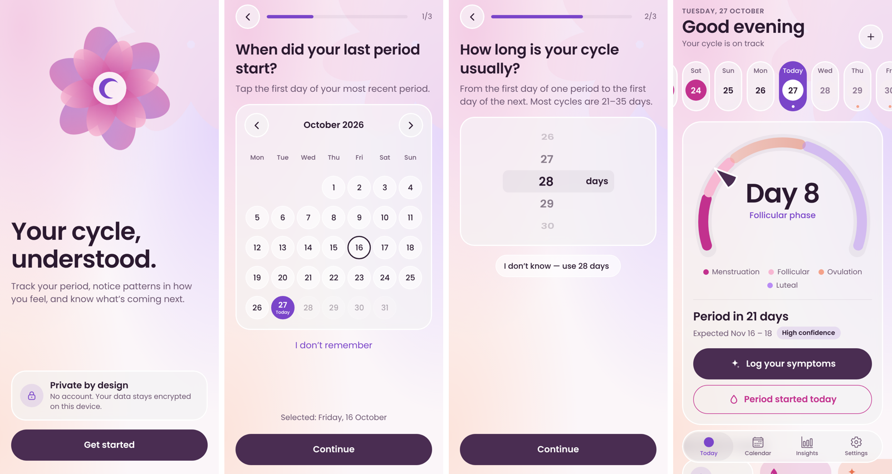
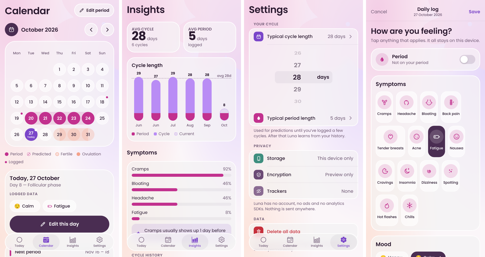
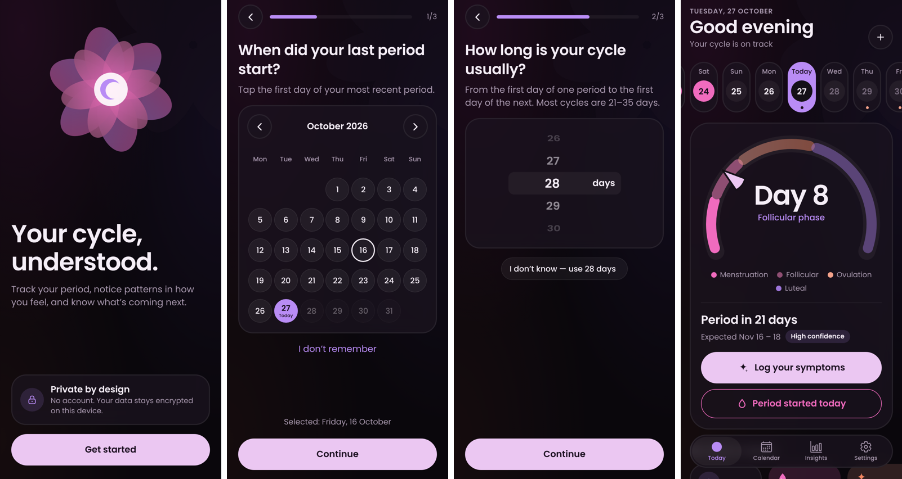
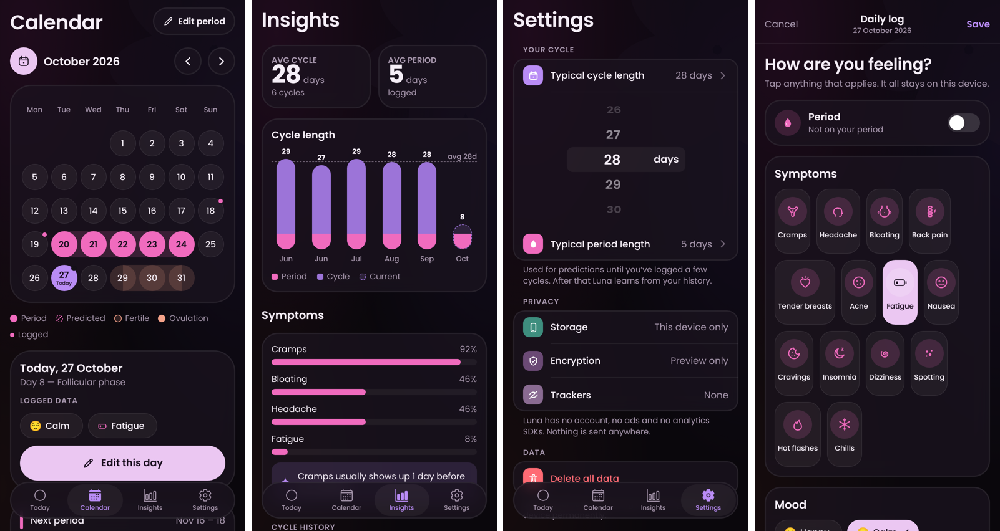

# Luna — private cycle companion (v1, work in progress)

"Luna" is a working name. Built with **Expo SDK 58 · React Native 0.88 · Expo Router · TypeScript**.

## Run it

```bash
npm install
npx expo start          # scan the QR code with Expo Go (iOS / Android)
npm test                # prediction-engine unit tests
npm run typecheck
```

> **Encryption needs a development build.** Expo Go doesn't include SQLCipher, so data is plain SQLite there.
> For real encryption and the real Liquid Glass tab bar on iOS 26, run `npx expo run:ios` / `npx expo run:android`
> (or `npx eas-cli@latest build --profile development`). The Settings → Privacy → Encryption row shows whether it's active.

## What's in this drop

| Area | Status |
|---|---|
| Onboarding: welcome → name → last period (calendar) → cycle length (wheel) → period length (wheel) → privacy promise | ✅ |
| Today: capsule week strip, phase arc gauge, insight tiles, phase strip, next-period range + confidence, today's log | ✅ |
| Calendar: month view with period / predicted / fertile / ovulation, tap to log, "Edit period days" mode | ✅ |
| Daily log sheet: period toggle + flow drops, 15 symptom tiles (3 columns), 10 moods, energy, notes | ✅ |
| Insights: averages, cycle-length bars, symptom strips, "usually shows up X days before" pattern, irregularity notice, history | ✅ |
| Settings: name, typical lengths (inline wheels), reminders, security, privacy status, delete all data | ✅ |
| App lock: 4-digit PIN + Face ID / fingerprint, auto-lock (immediately / 1 / 5 min), app-switcher cover, attempt lockout | ✅ |
| Reminders: period coming up, fertile window, daily check-in, pill — discreet wording by default, Timer-style time wheels | ✅ |

## Apple-style UI decisions

- **Liquid Glass**: `src/components/Glass.tsx` uses `expo-glass-effect` (`GlassView`) on iOS 26+, falls back to
  `expo-blur` frosted material elsewhere, and to a solid surface when *Reduce Transparency* is on.
- **Native tab bar**: `expo-router/native-tabs` → the system Liquid Glass tab bar on iOS 26, minimises on scroll.
  (`_layout.web.tsx` draws a lookalike for browser previews only.)
- **Timer-style wheel** (`WheelPicker.tsx`): 3D drum on the UI thread (Reanimated), snap-to-row, and a
  selection haptic each time a row crosses the centre — the same "detent" feel as Clock › Timer.
- **Haptic vocabulary** (`lib/haptics.ts`): tick (wheels, segmented controls, chips, day taps), light tap (buttons),
  medium thud (period on/off), success (save), warning (delete).
- **Bars & strips**: week strip, phase strip, cycle-length bars, symptom percentage strips.
- Large titles, inset-grouped lists, sliding segmented controls, SF-style type scale, continuous corners.

## Privacy architecture

- No account, no network calls, no analytics SDKs.
- SQLite + SQLCipher (`app.json` → `expo-sqlite` plugin `useSQLCipher: true`).
- 256-bit random key generated on first launch, stored in Keychain / Keystore via `expo-secure-store`
  (`WHEN_UNLOCKED_THIS_DEVICE_ONLY`, so it isn't included in backups). `android.allowBackup` is off.
- **Reminders are local notifications only** (`expo-notifications`, remote push disabled) — no push token, no server.
  Discreet mode (on by default) uses generic wording so nothing about the cycle shows on the lock screen;
  Android notifications are marked `PRIVATE` on the lock screen too. Reminders reschedule automatically when logs change.
- **App lock**: the PIN is stored only as a salted, iterated SHA-256 hash in Keychain/Keystore. 5 wrong tries → 30 s pause,
  doubling up to 15 min. Biometrics use `disableDeviceFallback` (the phone passcode isn't accepted — only Luna's PIN).
  There is deliberately no PIN recovery: forgetting it (without biometrics) means erasing the data.
- The screen is covered in the app switcher when app lock is on.

### Testing notes
- Face ID does **not** work in Expo Go (iOS) — use a development build. PIN lock works everywhere.
- Local notifications work in Expo Go. After changing `app.json` plugins, rebuild the dev build.

## Design (v0.2)

- **Palette "Orchid Dusk"** (`src/theme/tokens.ts`): plum `#4A2D52` buttons, magenta `#C2318E` period,
  peach `#F4A28A` fertile, coral `#E8734F` ovulation, lavender `#B98CF5` luteal, violet `#7A45C9` accent.
  Every text-on-colour pair passes WCAG AA.
- **Dark mode** is near-black (`#0A070C`) with very faint glows and pale-orchid buttons.
- **Type**: Poppins (400/500/600/700) via `@expo-google-fonts/poppins`.
- **Custom SVG** (`components/icons.tsx`, `ArcGauge.tsx`, `MonthCalendar.tsx`): symptom icon set, flow drops,
  phase arc gauge with pointer, bloom illustration, hatched predicted days, petal background.
- **Calendar**: glass circle days, connected range bands for period/fertile days, hatched predictions,
  logged-day dots, day detail card, "Edit period" mode.
- **Toggle**: custom spring toggle (replaces the platform Switch).

## Structure

```
src/
  app/                 Expo Router screens
    (tabs)/            Today, Calendar, Insights, Settings
    onboarding/        Welcome, Setup, Privacy
    log/[date].tsx     Daily log sheet
  components/          Glass, icons (custom SVG), ArcGauge, WheelPicker, Segmented, Chip, WeekStrip, PhaseStrip, MonthCalendar, CycleBars, ui
  data/                types, db.ts (SQLCipher), db.web.ts (preview only)
  lib/                 cycle.ts (prediction engine + tests), dates, haptics, catalog
  store/               Zustand store
  theme/               tokens + hooks
```

Predictions are estimates for awareness only — never contraception, never a diagnosis.

## Preview





